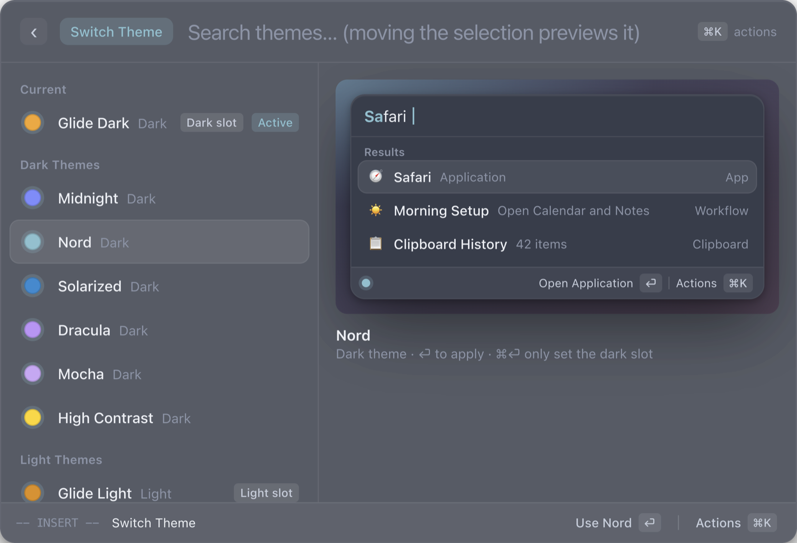
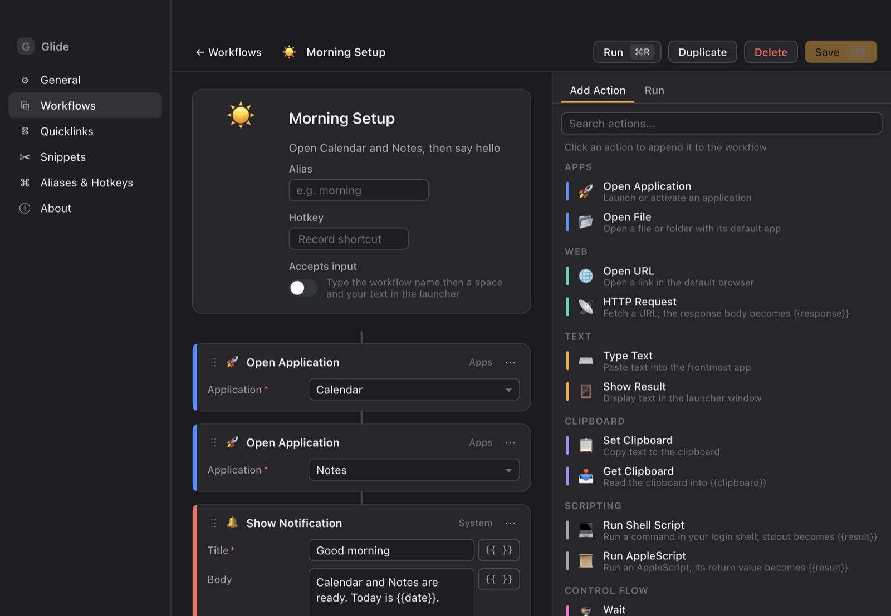
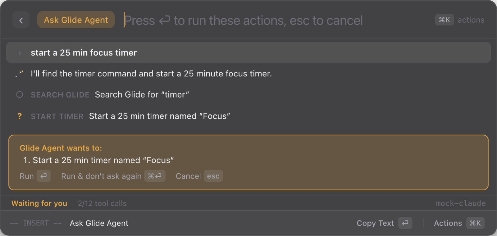
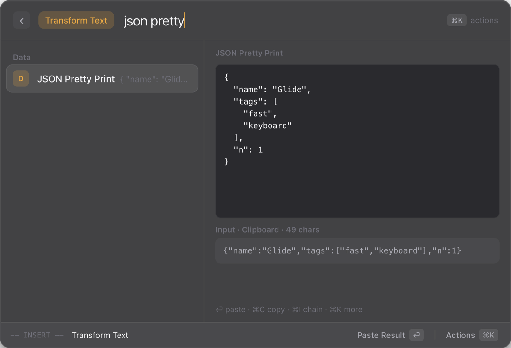
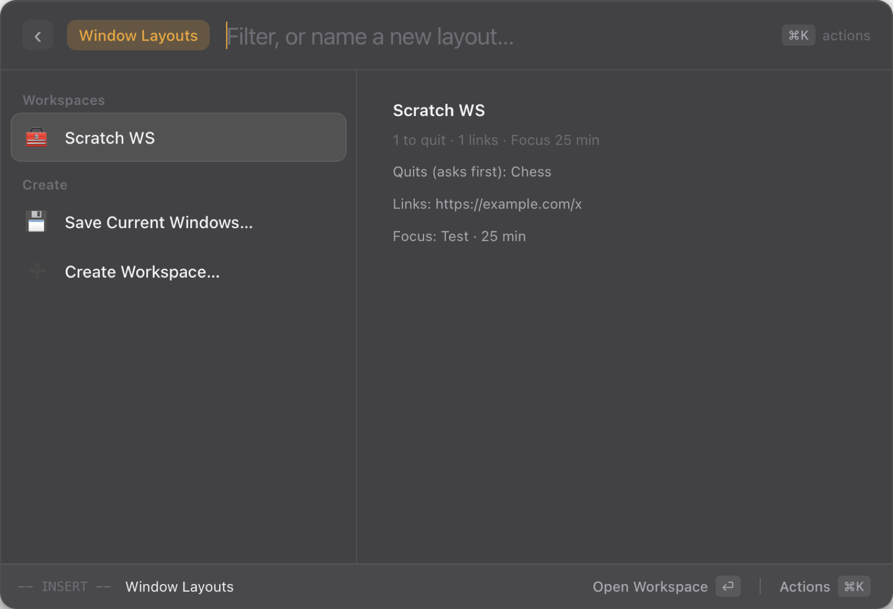

<div align="center">


# Glide

**A keyboard-first launcher for macOS, with a Shortcuts-style workflow builder, an AI agent, and vim keys everywhere.**

[](https://github.com/tobibytes/glide/actions/workflows/ci.yml)


[](LICENSE)



</div>

Press **⌘Space**, type a few letters, hit **⏎**. Glide finds apps, files, bookmarks and commands, runs your workflows, converts anything, manages windows, and lets an AI agent do multi-step chores for you. Everything works from the keyboard, with `j`/`k` vim navigation in every list.

## Highlights

| | |
| --- | --- |
| 🔎 **Fast fuzzy search** | Subsequence matching, aliases and frecency ranking ([how it ranks](src/engine/README.md)) |
| 🧩 **Workflows** | A Shortcuts-style visual builder: 17 actions, variables, conditions, hotkeys |
| ⚡ **Automations** | Run workflows on a schedule, on app launch, Wi‑Fi change, battery, display, folder changes or a hotkey |
| 🤖 **Glide Agent** | "Put Safari left, Notes right and start a 25 min timer". Claude plans it, you confirm, Glide does it, with undo, conversations and Save as Workflow |
| 🪟 **Windows & workspaces** | Snap windows, save and restore layouts, open whole workspaces in one keystroke |
| 📋 **Clipboard history** | List or image grid, filters, text search inside images, Paste Stack, merge, edit before pasting |
| ✂️ **Snippets & quicklinks** | `{cursor}`, dates, nested snippets, rich text, keyword prefix; quicklinks with several arguments and open-with |
| 🗓️ **Reminders & Finder** | "remind call mom tomorrow 9am", plus actions on the Finder selection (copy path, terminal here, move, compress) |
| 📍 **Menu bar** | Live timers, CPU and memory, next meeting, clipboard and agent shortcuts |
| 🔤 **Text transforms** | 34 transforms (case, JSON, Base64, hashes, JWT…) on your selection, pasted back |
| 🔢 **Conversions** | Units, ~160 currencies, time zones and date math, right in the search bar |
| 👁️ **Screen text & QR** | Capture any region and get the text (Apple Vision), or scan a QR code |
| 🌐 **Bookmarks & history** | Chrome, Arc, Brave, Edge, Vivaldi, Firefox and Safari |
| 🧰 **Dev tools** | Kill a process or a port, a live system monitor, script commands |
| 🎨 **Themes** | 9 themes, custom accent, density, translucency, all live-previewed |
| 🧱 **Extensions & store** | Glide's own API **and** Raycast-style React extensions (menu bar, background refresh, OAuth, AI), plus an in-app store with checksum-verified installs |
| 🔄 **Sync** | Settings sync and backup through any folder (iCloud Drive, Dropbox…), with no server |
| ⌨️ **Vim mode** | `j`/`k`, `gg`/`G`, `/`, counts, plus normal and insert modes in every list |

Plus Quick AI and AI commands on selected text, menu-bar search for any app, a Hyper key, emoji, notes and floating notes, focus sessions, calendar, timers and stopwatch, a color picker, quicklinks, and system commands.

<table>
  <tr>
    <td></td>
    <td></td>
  </tr>
  <tr>
    <td align="center"><sub>Build workflows like Shortcuts</sub></td>
    <td align="center"><sub>Glide Agent asks before it acts</sub></td>
  </tr>
  <tr>
    <td></td>
    <td></td>
  </tr>
  <tr>
    <td align="center"><sub>Transform the selected text</sub></td>
    <td align="center"><sub>Save and restore workspaces</sub></td>
  </tr>
</table>

## Download

Grab `Glide-darwin-universal.zip` from the [latest release](https://github.com/tobibytes/glide/releases/latest), unzip it, and move **Glide.app** to Applications.

Release builds are not notarized by Apple yet, so the first launch is blocked with "Glide can't be opened". To allow it, choose one:

- **System Settings → Privacy & Security**, scroll to the message about Glide, and click **Open Anyway**.
- **Terminal:** `xattr -dr com.apple.quarantine /Applications/Glide.app`

Glide then walks you through the hotkey, permissions and an optional AI key. It updates itself from GitHub Releases; turn that off in Settings → Updates. To uninstall, quit Glide, delete the app, and delete `~/Library/Application Support/Glide`.

## Build from source

Requirements: macOS 14+ on Apple silicon, Node 22+, pnpm 10, Xcode command-line tools (for the Swift helper).

```sh
git clone https://github.com/tobibytes/glide.git && cd glide
pnpm install
node scripts/setup-signing.mjs   # optional, once: keeps macOS permissions across rebuilds
pnpm install:app                 # build, sign and install /Applications/Glide.app
```

Then open Glide and press **⌥Space**. You can switch it to ⌘Space in Settings → Keyboard, which hands the shortcut over from Spotlight.

For development:

```sh
pnpm dev          # Vite + esbuild watch + Electron
pnpm test         # 906 unit tests
pnpm typecheck
pnpm test:e2e     # drives the real app headless (nothing appears on screen)
pnpm test:quality # smoke, performance and accessibility suites; see docs/TESTING.md
```

Some features need macOS permissions; Glide asks when you first use them:

- **Accessibility:** windows, menus, pasting, selected text
- **Input Monitoring:** snippets, Hyper key
- **Screen Recording:** screen text and QR
- **Calendars:** calendar events

More detail: [docs/INSTALL.md](docs/INSTALL.md) (signing, releases, auto-update, notarization).

## Keyboard

| Keys | Action |
| --- | --- |
| ⌘Space / ⌥Space | Show or hide Glide |
| ⏎ / ⌘⏎ | Primary / secondary action |
| ⌘K | All actions for the selected item |
| Tab | Give an argument (quicklink `{query}`, workflow input, AI command) |
| `j` `k` · `gg` `G` · `/` | Vim navigation (Esc switches to normal mode) |
| ⌃J / ⌃K | Down / up, even while typing |
| ⌘1–9 | Run the n-th visible item |
| Esc | Back, clear, then hide |

## Docs

- [Features](docs/FEATURES.md): everything Glide does, with commands and shortcuts
- [Architecture](docs/ARCHITECTURE.md): how the pieces fit together
- [Writing extensions](src/extension-api/README.md): Glide API and Raycast-style React extensions
- [Extension store](docs/EXTENSIONS-STORE.md) · [Testing](docs/TESTING.md)
- [Search ranking](src/engine/README.md)
- [Native helper protocol](src/native/PROTOCOL.md)
- [Changelog](CHANGELOG.md) · [Contributing](CONTRIBUTING.md) · [Security](SECURITY.md)

## Roadmap

**v0.3 (shipped):**
- menu-bar mode
- Clipboard 2.0
- extension store
- universal (Intel + Apple silicon) builds with tag-triggered GitHub releases
- Raycast-compat (menu-bar commands, background refresh, OAuth, AI)
- Quicklinks & Snippets 2.0
- Reminders and Finder actions
- Glide Agent 2.0
- features as workflow steps
- the Tab chooser
- "Keep open after running"
- headless testing with visual, accessibility and performance suites

**v0.2, the top 10 (shipped):**

Ranked by how much they change day-to-day use:

1. **Automations**: event-triggered workflows (time, apps, Wi‑Fi, power, displays, folders, hotkeys)
2. **Glide Agent**: natural-language, multi-step actions with Claude tool use and confirmations
3. **Window layouts & workspaces**: save, restore and launch whole setups
4. **Screen text & QR**: OCR any region with Apple Vision
5. **Browser bookmarks & history**: every major browser, local only
6. **Text transforms**: 34 transforms on the selection, pasted back
7. **Process & port manager**: kill by name or by port, safely
8. **Themes & appearance**: 9 themes, accents, density, translucency
9. **System monitor**: live CPU, memory, disk, battery and network
10. **Sync & backup**: through any synced folder, with deterministic merges

Next up: ⌘V-driven Paste Stack and live snippet placeholders (needs a helper change), and notarized releases.

## Background

Glide started as a study of how Raycast's root search works. Its search ranking is a port of the algorithm recovered from Raycast 2.8.2 by static reverse engineering. The research notes are not part of this repository; `src/engine/README.md` describes every rule and each deliberate deviation. Glide is an independent project, not affiliated with or endorsed by Raycast.

## License

[MIT](LICENSE) © 2026 tobibytes
