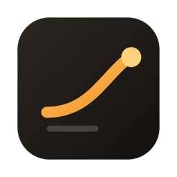
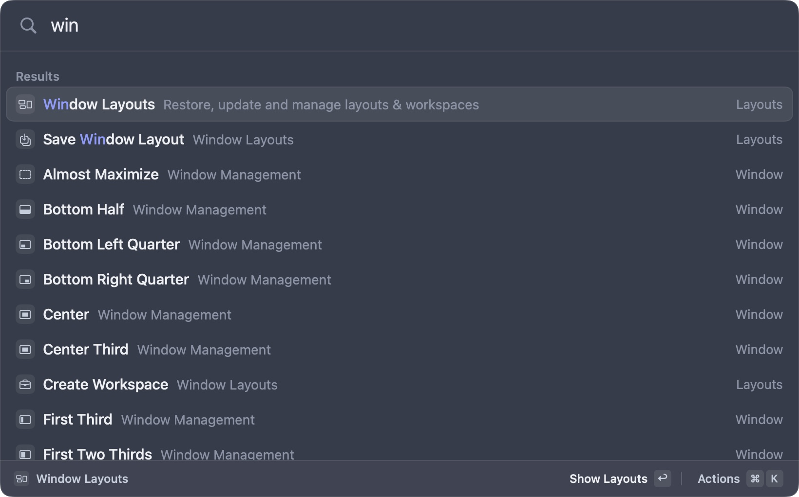
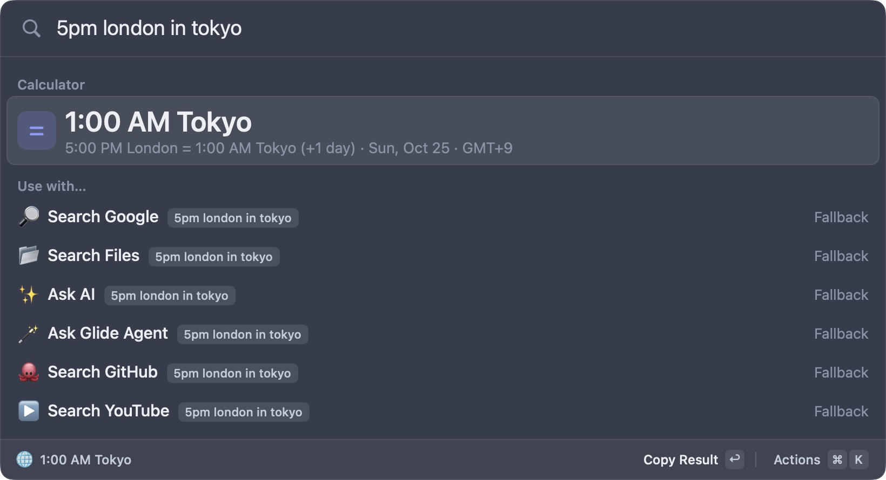
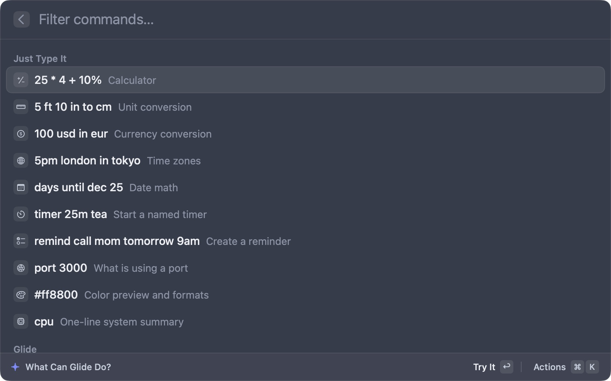

<div align="center">



# Glide

**A free, open-source, keyboard-first launcher for macOS.**

**[glide.madebytobi.com](https://glide.madebytobi.com)** &nbsp;|&nbsp; **[Download](https://github.com/tobibytes/glide/releases/latest)**


[](https://github.com/tobibytes/glide/releases/latest)
[](LICENSE)



</div>

Press **⌥Space** (or switch it to **⌘Space**), type a few letters, hit **⏎**. Glide opens apps and files, snaps windows, searches your clipboard, expands snippets, converts anything, asks AI with your own key or a local model, and automates your Mac. It's a native Swift app that stays at about 30 MB of memory, with no account and no tracking.

New to it? Type `help` and open **What Can Glide Do?** to see every command.

## Highlights

| | |
| --- | --- |
| 🔎 **Fast fuzzy search** | Apps, files, commands and bookmarks, with aliases, hotkeys and ranking by what you use most |
| ⌨️ **Just type it** | `5pm london in tokyo`, `100 usd in eur`, `timer 25m tea`, `remind call mom tomorrow 9am`, `port 3000` |
| 📋 **Clipboard history** | List or image grid, filters, text search inside images, Paste Stack, merge, edit before pasting |
| ✂️ **Snippets & quicklinks** | Expand as you type, with `{cursor}`, dates, nested snippets and rich text; quicklinks with arguments |
| 🪟 **Windows & workspaces** | Snap windows, save and restore layouts, open whole workspaces in one keystroke |
| ✨ **AI on your terms** | Quick AI, AI Chat and AI commands on selected text. Bring an Anthropic or OpenAI key, or use a local model through Ollama or LM Studio. Keys stay in the Keychain |
| 🤖 **Glide Agent** | "Put Safari left, Notes right and start a 25 min timer". It shows its plan, asks before acting, and can undo |
| ⚡ **Automations & workflows** | A visual workflow builder, run on a schedule, on app launch, Wi‑Fi or power changes, or when a file lands in a folder |
| 👁️ **Screen text & QR** | Drag over any region to copy its text (Apple Vision, on your Mac), or scan a QR code |
| 🧱 **Extensions & MCP** | An extension store, Raycast-style React extensions, and an MCP server so tools like Claude Code can use Glide |
| 🧰 **Mac tools** | Color picker, process and port killer, system monitor, menu search, Finder actions, text transforms, timers, focus, floating notes, reminders, calendar |
| 📱 **Glide on iPhone** (beta) | Glide Remote on your phone: run commands, send text, links and photos to the Mac, sync the clipboard both ways, a trackpad and slide clicker, pull files, and ask Glide Agent. Plus Shortcuts that work away from home and phone notifications. Paired by QR code, encrypted, off by default |
| 🎨 **Yours** | Themes with live preview, a Hyper key, vim keys, and sync through iCloud Drive or Dropbox |

<table>
  <tr>
    <td></td>
    <td></td>
  </tr>
  <tr>
    <td align="center"><sub>Type what you mean</sub></td>
    <td align="center"><sub>Every command, one keystroke away</sub></td>
  </tr>
</table>

## Download

Grab **`Glide-<version>.dmg`** from the [latest release](https://github.com/tobibytes/glide/releases/latest) or [glide.madebytobi.com](https://glide.madebytobi.com). It runs on Apple silicon and Intel Macs with macOS 14 or later. Open it and drag **Glide** onto **Applications**.

Release builds aren't notarized by Apple yet, so the first launch is blocked with "Glide can't be opened". To allow it, choose one:

- Open **System Settings**, then **Privacy & Security**, scroll to the message about Glide, and click **Open Anyway**.
- Or in Terminal: `xattr -dr com.apple.quarantine /Applications/Glide.app`

Glide then walks you through your hotkey, permissions (with live status), an optional AI key and a theme. It updates itself from GitHub Releases; you can turn that off in Settings. To uninstall, quit Glide, delete the app, and delete `~/Library/Application Support/Glide`.

Some features need macOS permissions, and Glide asks when you first use them:

- **Accessibility:** windows, menus, pasting, selected text
- **Input Monitoring:** snippets, Hyper key
- **Screen Recording:** screen text and QR
- **Calendars and Reminders:** events and reminders

## Build from source

Requirements: macOS 14+, Xcode 16 or the Swift 6 toolchain. There are no third-party dependencies.

```sh
git clone https://github.com/tobibytes/glide.git && cd glide/macos
swift build                    # debug build
scripts/test.sh                # builds, then runs every test headless (nothing appears on screen)
scripts/build-app.sh           # universal release app in build/Glide.app, signed
scripts/make-dmg.sh            # build/Glide-<version>.dmg
scripts/release.sh --publish   # build, package and publish a GitHub release
```

More detail: [macos/README.md](macos/README.md) (layout, headless test server) and [docs/INSTALL.md](docs/INSTALL.md) (signing, releases, auto-update).

## Keyboard

| Keys | Action |
| --- | --- |
| ⌥Space (or ⌘Space) | Show or hide Glide |
| ⏎ / ⌘⏎ | Primary / secondary action |
| ⌘K | All actions for the selected item |
| Tab | Give an argument (quicklink `{query}`, workflow input, AI command) |
| `j` `k`, `gg` `G`, `/` | Vim navigation (Esc switches to normal mode) |
| ⌃J / ⌃K | Down / up, even while typing |
| ⌘1–9 | Run the n-th visible item |
| Esc | Back, clear, then hide |

## Docs

- [Features](docs/FEATURES.md): everything Glide does, with commands and shortcuts
- [Native app](macos/README.md), [architecture](macos/docs/ARCHITECTURE.md) and [testing](macos/docs/TESTING.md)
- [Glide on iPhone](docs/PHONE.md): design, security and Shortcuts setup
- [MCP server](docs/MCP.md) and [MCP client](docs/MCP-CLIENT.md)
- [Writing extensions](src/extension-api/README.md): Glide API and Raycast-style React extensions
- [Extension store](docs/EXTENSIONS-STORE.md)
- [Search ranking](src/engine/README.md)
- [Changelog](CHANGELOG.md), [Contributing](CONTRIBUTING.md) and [Security](SECURITY.md)

## Roadmap

**v0.4 (shipped):** Glide on iPhone (beta): Glide Remote, Send to Mac, two-way clipboard sync, remote control, files, Glide Agent and approvals from the phone, iPhone Shortcuts through iCloud Drive, and notifications through ntfy. Text recognition now runs in a short-lived helper, so Glide stays at about 30 MB.

**v0.3 (shipped):** a full native Swift rewrite (universal, about 30 MB of memory), What Can Glide Do?, local AI models without a key, OpenAI alongside Anthropic, menu-bar extras, Clipboard 2.0, the extension store, Raycast-style extensions (menu bar, OAuth, AI), Quicklinks and Snippets 2.0, Reminders and Finder actions, and Glide Agent 2.0.

**v0.2 (shipped):** automations, Glide Agent, window layouts and workspaces, screen text and QR, browser bookmarks and history, text transforms, the process and port manager, themes, the system monitor, and sync and backup.

**Next up:** notarized releases, so the first launch needs no extra step, and a native iPhone app with widgets.

The original Electron version is still in `src/` for reference, but releases now ship the native app in `macos/`.

## Independent project

Glide is an independent open-source project. It is not affiliated with or endorsed by Raycast; "Raycast-style extensions" means Glide can run extensions written for Raycast's public extension API.

## License

[MIT](LICENSE) © 2026 tobibytes
